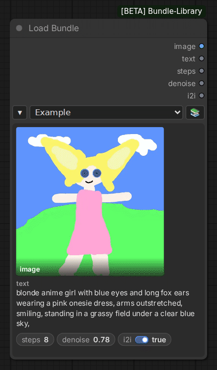
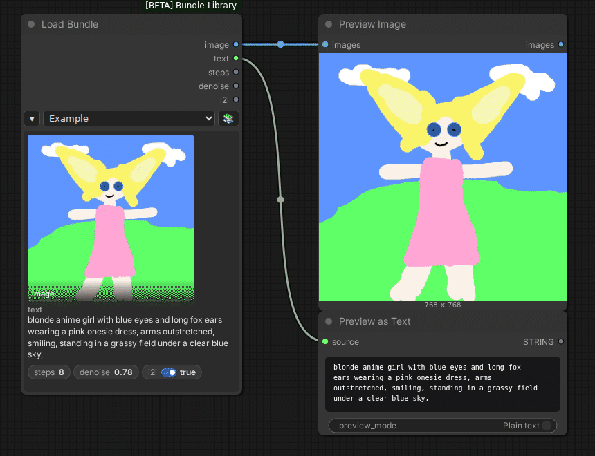
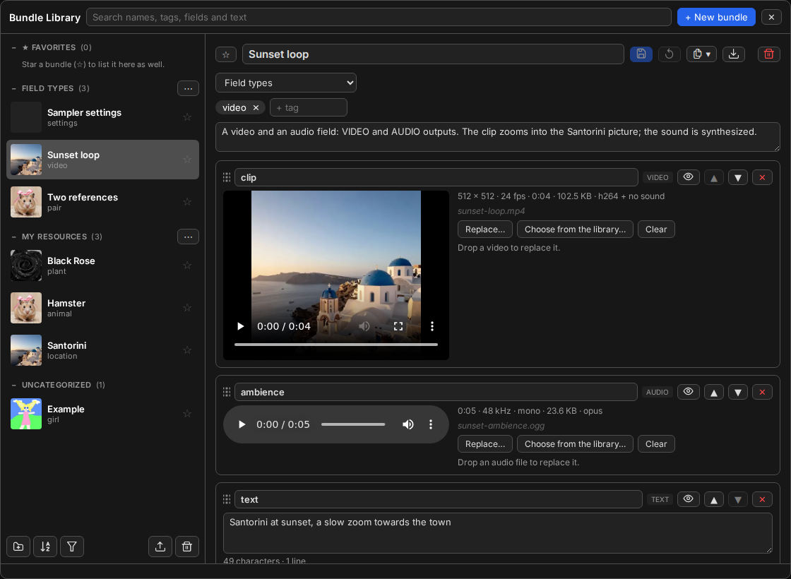

# ComfyUI용 Bundle Library

함께 쓰는 입력(프롬프트, 이미지, 동영상, 오디오, 설정값)을 이름 붙인 **번들**로 묶어 두고, 노드 하나로 원하는 번들을
불러와 보세요.

[English](README.md) | 한국어



## 소개

같은 워크플로를 입력만 바꿔 가며 돌릴 때가 많습니다. Bundle Library는 그런 입력 묶음을 번들로 보관하고, **Load
Bundle** 노드는 고른 번들을 워크플로에 넣어 줍니다. 입력 구성은 같고 값만 다른 번들끼리는 다시 연결할 필요 없이 바꿔
쓸 수 있습니다.

번들은 ComfyUI가 실행되는 곳의 전용 라이브러리에 보관되므로, 어느 워크플로에서나 쓸 수 있습니다.

## 주요 기능

- **노드 하나로 어떤 입력이든**: Load Bundle 노드의 출력 단자는 고른 번들을 따라, 번들의 입력마다 하나씩 생깁니다.
- **여러 종류의 입력**: 한 번들에 텍스트, 숫자, 스위치, 이미지, 동영상, 오디오를 함께 담을 수 있습니다.
- **라이브러리 창**: 번들을 만들고, 고치고, 찾고, 정리할 수 있습니다.
- **파일은 한 번만 저장**: 여러 번들이 같은 파일을 써도 한 번만 저장되고, 저장된 파일은 새 번들에서 다시 쓸 수
  있습니다.
- **가져오기와 내보내기**: 번들을 파일과 함께 ZIP 파일로 내보내 두었다가, 나중에 이 라이브러리나 다른 라이브러리로
  가져올 수 있습니다.
- **HTTP API**: 스크립트나 AI 에이전트도 번들을 만들고, 고치고, 쓸 수 있습니다.

## 설치

ComfyUI 0.38.0 이상이 필요합니다.

- **ComfyUI-Manager**: **Bundle Library**를 검색해 설치합니다.
- **comfy-cli**: `comfy node install bundle-library`
- **직접 설치**:

  ```bash
  cd ComfyUI/custom_nodes
  git clone https://github.com/romanyogurt/ComfyUI-Bundle-Library
  ```

설치한 뒤에는 ComfyUI를 다시 시작해 주세요.

## 예제 워크플로

예제 워크플로 하나와, 그 워크플로에 맞춘 번들 네 개, 다른 종류의 입력을 담은 번들 세 개가 함께 들어 있습니다.

1. **예제 열기**: **워크플로 → 템플릿 탐색**에서 **z-image-turbo**를 검색하세요. 번들의 프롬프트로 이미지를
   만들거나, 번들의 이미지에서 출발해(이미지에서 이미지로) Z-Image Turbo로 새 이미지를 만드는 워크플로입니다. 필요한
   모델과 넣을 폴더는 워크플로 안의 메모에 적혀 있습니다.
2. **예제 번들 가져오기**: 사이드바의 상자 아이콘에서 **라이브러리 열기**를 누릅니다. 라이브러리가 비어 있으면
   **예제 가져오기** 버튼이 보이니, 누른 다음 **번들 7개 가져오기**를 누르세요.
3. **실행하기**: 워크플로의 Load Bundle 노드에서 번들을 골라 실행합니다. 다른 번들로 바꿔 다시 실행해 보세요.



**Field types** 묶음의 번들 세 개는 다른 종류의 입력을 담고 있습니다(동영상과 오디오, 숫자와 스위치, 이미지 두 장).
Load Bundle 노드에서 골라 보면 출력 단자가 번들에 맞춰 바뀝니다.

나만의 번들을 만들려면, 예제 하나를 고른 뒤 **복제 → 값까지 복제**로 복제하고 프롬프트와 이미지를 바꿔 저장하세요.
같은 워크플로에서 그대로 쓸 수 있습니다. 더 자세한 내용은
[Getting started](https://github.com/romanyogurt/ComfyUI-Bundle-Library/blob/main/wiki/Getting-started.md)(영어)를 참고하세요.



## 문서

자세한 설명은 모두 [문서](https://github.com/romanyogurt/ComfyUI-Bundle-Library/blob/main/wiki/Home.md)(영어)에
있습니다.

- **사용법**: [Getting started](https://github.com/romanyogurt/ComfyUI-Bundle-Library/blob/main/wiki/Getting-started.md),
  [Bundles and fields](https://github.com/romanyogurt/ComfyUI-Bundle-Library/blob/main/wiki/Bundles-and-fields.md),
  [The Load Bundle node](https://github.com/romanyogurt/ComfyUI-Bundle-Library/blob/main/wiki/The-Load-Bundle-node.md),
  [The library window](https://github.com/romanyogurt/ComfyUI-Bundle-Library/blob/main/wiki/The-library-window.md),
  [Import and export](https://github.com/romanyogurt/ComfyUI-Bundle-Library/blob/main/wiki/Import-and-export.md),
  [Images, video and audio](https://github.com/romanyogurt/ComfyUI-Bundle-Library/blob/main/wiki/Images-video-and-audio.md),
  [Data and backups](https://github.com/romanyogurt/ComfyUI-Bundle-Library/blob/main/wiki/Data-and-backups.md),
  [FAQ and troubleshooting](https://github.com/romanyogurt/ComfyUI-Bundle-Library/blob/main/wiki/FAQ-and-troubleshooting.md)
- **참조**: [HTTP API](https://github.com/romanyogurt/ComfyUI-Bundle-Library/blob/main/wiki/HTTP-API.md),
  [File formats](https://github.com/romanyogurt/ComfyUI-Bundle-Library/blob/main/wiki/File-formats.md),
  [Compatibility and versions](https://github.com/romanyogurt/ComfyUI-Bundle-Library/blob/main/wiki/Compatibility-and-versions.md),
  [Automating with the API](https://github.com/romanyogurt/ComfyUI-Bundle-Library/blob/main/wiki/Automating-with-the-API.md)
- **기여**: [Translations](https://github.com/romanyogurt/ComfyUI-Bundle-Library/blob/main/wiki/Translations.md),
  [Reporting problems](https://github.com/romanyogurt/ComfyUI-Bundle-Library/blob/main/wiki/Reporting-problems.md),
  [코드 기여 안내](CONTRIBUTING.md)

AI 에이전트를 위해서는 [`llms.txt`](llms.txt)가 이 문서들의 텍스트 버전을 안내합니다.

## 업데이트

바뀐 내용은 [변경 기록](CHANGELOG.md)(영어)과
[릴리스 페이지](https://github.com/romanyogurt/ComfyUI-Bundle-Library/releases)에서 확인하실 수 있습니다. 번들은
`ComfyUI/user/bundle_library/` 폴더에 있으니, 업데이트하기 전에 이 폴더를 백업해 두세요.

## 알아 두실 점

- ComfyUI에 접속할 수 있는 사람이면 누구나 라이브러리도 쓸 수 있습니다.
- `--multi-user`로 실행하면 모든 사용자가 라이브러리 하나를 함께 씁니다.

더 자세한 내용은 [Data and backups](https://github.com/romanyogurt/ComfyUI-Bundle-Library/blob/main/wiki/Data-and-backups.md)를 참고하세요.

## 라이선스

Bundle Library는 [MIT 라이선스](LICENSE)로 배포됩니다. 일부 예제 파일은 다른 프로젝트에서 가져온 것이라 원래의
라이선스를 따릅니다. 자세한 내용은 [THIRD-PARTY-NOTICES.md](THIRD-PARTY-NOTICES.md)를 확인해 주세요.
